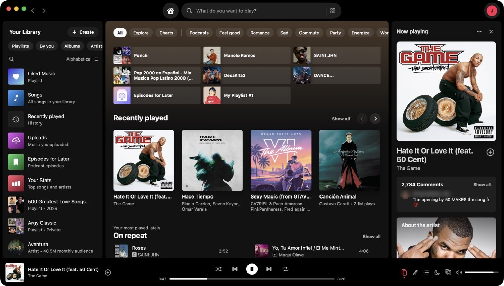

# YT Musicfast

[](https://github.com/MijaelFV/YTMusicfast/actions/workflows/ci.yml)
[](LICENSE)

A fast, native macOS app for YouTube Music.
SwiftUI + AVFoundation: no Electron, no browser hidden inside. An ~11 MB download that uses ~150 MB of RAM.



<p align="center">
  
  
  
</p>

> **Independent project.** YT Musicfast is not affiliated with, endorsed or sponsored by Google or YouTube.
> It talks to YouTube Music's private web API, which can change without notice — when that happens,
> playback may stop until an update ships.

## Install

> **Status: early.** YT Musicfast is young and changes quickly — expect rough edges, and please
> [report what you find](https://github.com/MijaelFV/YTMusicfast/issues/new/choose).

1. Download the latest `YTMusicfast-x.y.z.dmg` from [**Releases**](https://github.com/MijaelFV/YTMusicfast/releases).
2. Open it and drag **YT Musicfast** into **Applications**.
3. Open YT Musicfast. If macOS says it can't verify the developer (builds that aren't notarized yet),
   go to **System Settings → Privacy & Security**, scroll down and click **Open Anyway**.
   You only need to do this once: updates install themselves from then on (Settings → General → Updates).

Or with Homebrew (this repository is also a tap):

```bash
brew tap mijaelfv/ytmusicfast https://github.com/MijaelFV/YTMusicfast
brew install --cask ytmusicfast
```

Requires macOS 15 Sequoia or later.

## Features

### Beyond YouTube Music

What you don't get from YouTube Music in a browser tab:

- **A real Mac app** — native SwiftUI + AVFoundation, ~150 MB of RAM instead of a browser tab, 0% CPU while idle
- **Better sound** — YouTube's Opus stream (~160 kbps) instead of its 128 kbps AAC; with **Premium**, Premium's own
  **Opus 256 kbps**. Plus a 10-band **equalizer** with presets, **crossfade** (0–12 s), **gapless** playback,
  **volume normalization**, **balance** and **mono audio**
- **Downloads and offline** — save albums and playlists (including Liked Music); **Offline Mode**; songs you've played
  are kept for instant, data-free replays (500 MB–10 GB); search finds your own music when you're offline
- **Music videos up to 4K** — every size YouTube offers (1440p/4K on Macs that decode AV1), chosen by the size it's
  shown at and your connection, or fixed from the ⚙︎ **Video quality** menu (which, in full screen, can also make a
  video fill the screen)
- **Content filter** — hide AI-generated music (your marks, a shared AI-artist list, tell-tale titles and YouTube's
  "altered or synthetic content" label), explicit songs, unplayable songs, and artists or songs you hide — at hand in
  search too
- **Your Stats** — top songs and artists, minutes listened and when you listen (4 weeks to all time), kept on your Mac;
  save your top songs as a playlist; an **On repeat** shelf on Home
- **Listen together** — listening sessions with people nearby: you let each person in, then everyone can play, pause,
  skip and add songs
- **Play anywhere** — **Google Cast** (Chromecast, Google TV, Nest), **AirPlay** (HomePod, Apple TV, smart TVs) and any
  speaker or headphones from the Connect panel; a **phone remote** in your phone's browser (QR code + PIN)
- **Local Files** — play music folders from your Mac alongside YouTube Music
- **Smart Shuffle**, **Snooze** a song for 30 days, a **sleep timer** and **playback speed** (0.5–2×)
- **Skip non-music parts** of music videos — intros, skits and outros marked by the SponsorBlock community (optional)
- **Visualizer** in the player bar — spectrum or waveform in the cover's colours (off by default)
- **Lyrics translation** on-device, **chapters** for long videos and podcasts, song credits
- **Full-screen TV mode** (⇧⌘F) — a lean-back player made for a big screen: the cover's colours over the whole
  screen, a big cover and title, controls that fade while the music plays (or pin them), an **Up next / Related** rail,
  synced **lyrics** beside the cover or as captions over a music video, an "Up next" card near the end of a song, and
  a clock. Works like a remote — arrows move a highlight, Return presses it, ← → seek and ↑ ↓ set the volume when the
  controls are hidden — and a trackpad swipe skips songs; the screen stays awake while it plays

### Everything you use in YouTube Music

- Sign in with Google (optional) for your mixes, Liked Music, playlists, history, likes and dislikes; what you play
  shows up on your phone and the website as it does from YouTube Music's own player — in History (and so Listen
  again), with how long you listened, which feeds your recommendations and Recap (can be turned off)
- **Your Library** with Playlists / Albums / Artists / Downloaded / By you filters, pins, recents, folders, sort and
  list/compact/grid views (works signed out); save albums and playlists, subscribe to artists
- **Your playlists** — create, rename, describe, set Public / Unlisted / Private, delete, add songs ("Find more" and
  recommendations), remove, drag to reorder; drag songs onto a playlist (or Liked Music) to add them
- Home with mood chips (Energize, Relax, Workout…), Quick picks, Explore, Charts by country, Moods & Genres
- **Search** — suggestions and instant results as you type (recent searches when empty), results on Return: a wide top
  result and one list of songs, artists, albums and playlists with lengths and plays; type chips (⌘1–⌘9, ⌃Tab)
- Artist pages with Popular (5, "See more" for 10), plays and lengths; album and playlist pages with sticky headers
- **Radio** from any song, album, playlist or artist, with YouTube Music's tuning chips (Popular, Discover, Deep cuts,
  moods, decades); **Go to radio** to see its songs, get a new mix or save it; starting one never interrupts the song
- **Queue** with drag-to-reorder and endless Autoplay; played songs stay in it and any song plays with a click
- **Song/Video switch** and a **player page** — the cover or music video big in the middle (click the player bar, ⌥⌘P);
  the next songs play in the mode you're in, their music video or their song version ready before they start
- **Thumbs up / down** — a thumbs down skips the song and plays less like it
- Time-synced **lyrics**, **comments** (sort, replies, post), "Related" music, **podcasts** (Episodes for Later,
  resume where you stopped), **uploads** of your own songs, private session

### Made for the Mac

- **Keyboard first** — shortcuts for everything (⌘/ lists them), arrow keys and Return through any song list,
  multi-select (⌘-click, ⇧-click), ⌘A / ⌘C / ⌘X / ⌘V songs as links, Delete removes from your playlist
- **Menu bar** mini player (optionally with the song's name), a floating **miniplayer** window, the full-screen TV
  player, a **notch player** on MacBooks with a notch, Dock menu, media keys and Control Center
- **Global shortcuts** that work while another app is in front; **Shortcuts, Siri and Spotlight** actions
- **Command line** — `ytmusicfast play-pause`, `next`, `now-playing --raw`, `play-search …`, `devices`, `diagnose`…
  for Terminal, scripts, Raycast and Alfred (install it from Settings → General → Command-line tool)
- **Links** — paste a music.youtube.com, youtube.com or youtu.be link (⌘V) to play or open it; `ytmusicfast://` links
- Song-change notifications, the system Share sheet, launch at login, VoiceOver, a search field in Settings
- Undo on removals, an "Already added" warning, remove songs from your listening history
- A dark design tinted by each cover — or light, or following the system; **English and Spanish**

### Fast and dependable

- **Opens instantly** — Home, Your Library and pages you've visited show last time's copy at once (also offline)
- **Songs start in about a second**; the next one is ready before the current one ends; skips fade without clicks;
  skipping through many songs quickly loads only the one you stop on
- **Keeps playing** — recovers from stalls and dropped connections, uses a lighter stream on slow networks and in
  Low Data Mode, pauses when your headphones disconnect, and picks up where you left off after a restart
- **Keeps working** when YouTube changes things: a backup client list in [`clients.json`](clients.json) fixes every
  install without an update, and `ytmusicfast diagnose` shows what's wrong

## Keyboard

| | |
|---|---|
| Space | Play / pause |
| M | Mute / unmute |
| B | Like / unlike current song |
| S / R | Shuffle / repeat |
| Q / L / F | Queue / lyrics / full-screen player |
| / or ⌘F / ⌘K | Search |
| ? or ⌘/ | All keyboard shortcuts |
| ⌘→ / ⌘← | Next / previous |
| ⌥⌘→ / ⌥⌘← | Skip ±10 s |
| ⌘↑ / ⌘↓ | Volume |
| ⌘S / ⌘R | Shuffle / repeat |
| ⇧⌘R | Start radio from current song (it keeps playing) |
| ⌘L | Like / unlike current song |
| ⇧⌘D | Dislike current song (skips it) |
| ⌘N | New playlist |
| ⌥⌘E | Equalizer |
| ⇧⌘P | Add current song to a playlist |
| ⌥⌘L | Lyrics |
| ⌥⌘P | Player page (cover or video in the middle; also: click the player bar) |
| ⇧⌘F | Full-screen TV player |
| ⌥⌘U | Toggle queue |
| ⌘[ / ⌘] | Back / forward |
| ⇧⌘H | Home |
| ⇧⌘L | Liked Music |
| ⇧⌘A / ⇧⌘B | Go to the playing artist / album |
| ⌘A / ⌘C / ⌘X / ⌘V | Select all songs / copy as links / cut / paste links into your playlist |
| ⌥⌘N | Toggle Now Playing view |
| ⌥⌘B | Collapse Your Library |
| ↑ / ↓, Return | Move through a song list, play the selected song |
| ⌘1–⌘9, ⌃Tab | On Search: pick a filter chip, next / previous |

In the full-screen player:

| | |
|---|---|
| ← / → | Seek 10 s (controls hidden) · move the highlight (controls showing) |
| ↑ / ↓ | Volume (controls hidden) · move between the progress bar, the buttons and the rail |
| Return | Show the controls · press the highlighted button or song |
| L / Q | Lyrics / Up next rail |
| P | Keep the controls showing |
| Esc | Close the rail, then leave full screen |
| Two-finger swipe | Next / previous song (trackpad) |
| Click the cover or video | Play / pause |

## Privacy

- Signing in happens on Google's own page inside the app; YT Musicfast never sees your password. The resulting
  youtube.com session cookies stay in the app's own private web storage and are only ever sent to youtube.com.
  Signing out deletes them.
- The app only talks to:
  - YouTube and Google: `music.youtube.com` / `www.youtube.com` (music data, comments, your library),
    `*.googlevideo.com` (audio and video), `*.ytimg.com`, `*.ggpht.com` and `*.googleusercontent.com`
    (covers and pictures), `accounts.google.com` (signing in), `upload.youtube.com` (only when you upload a song)
  - `lrclib.net` (lyrics)
  - GitHub: `api.github.com` and `github.com` (update check and downloads), `raw.githubusercontent.com` (this
    repository's `clients.json`, twice a day)
  - Only if you set or turn them on: your shared AI-artist list, and `sponsor.ajay.app` (non-music segments — asked
    by a 4-character hash prefix, so it never learns what you're playing)

  No analytics, no tracking, no servers of its own.
- Signed in, what you play is reported to your YouTube Music account the way YouTube's own player does it — that a
  song played (History) and which parts of it you heard — so your phone and the website stay in step. Turn it off in
  Settings ("Add songs I play to my YouTube Music history") or use a private session; local files are never reported.
- Your stats are computed from plays stored on your Mac (`~/Library/Application Support/YTMusicfast/plays.json`);
  private sessions aren't recorded, and Settings → General → Privacy → Listening stats clears them.
- Listen together and the phone remote only use your local network, and only while you turn them on. Listening
  sessions are encrypted and you approve each person who joins; the phone remote needs a 6-digit PIN and pauses
  after ten wrong tries.
- The command-line tool talks to the app over a message port only programs running as you on this Mac can reach.
- Pins, recents, stats and settings stay on your Mac. Last time's pages are cached in
  `~/Library/Caches/YTMusicfast/pages` (Settings → General → Storage → Saved pages; cleared when you sign out).

## Troubleshooting

**Songs won't play ("YouTube may have changed something").** YouTube periodically changes how its
streams work. Check for an update (an "Update to …" button appears next to your account when one is out). As an extra safety
net, if [yt-dlp](https://github.com/yt-dlp/yt-dlp) is installed (`brew install yt-dlp`), YT Musicfast
falls back to it automatically — keep it updated with `brew upgrade yt-dlp`.

**Something specific doesn't play.** `ytmusicfast diagnose <song link or id>` reports what YouTube offers for it
and what works (format numbers and yes/no only — no addresses or cookies); add `--video` for its music video.
Include the output in an issue. (The command-line tool installs from Settings → General → Command-line tool.)

**YouTube stopped answering for everyone.** Maintainers: put a working client (yt-dlp's client list is a good source)
in [`clients.json`](clients.json) and push — installs pick it up within hours, no update needed.

**One song is skipped.** Some tracks are region-locked, removed, or Premium/age-restricted; those are
skipped with a note in the player bar.

**Sign-in says the browser isn't secure.** Close the sheet and try again; Google occasionally
challenges embedded sign-ins.

## Building from source

Requires Xcode 26 and [XcodeGen](https://github.com/yonaskolb/XcodeGen) (`brew install xcodegen`).

```bash
xcodegen generate
open YTMusicfast.xcodeproj        # or build from the command line:
xcodebuild -project YTMusicfast.xcodeproj -scheme YTMusicfast -derivedDataPath build build
```

Tests (parsers run against captured YouTube responses; live checks are opt-in):

```bash
xcodebuild test -project YTMusicfast.xcodeproj -scheme YTMusicfast -derivedDataPath build
TEST_RUNNER_YTF_LIVE=1 xcodebuild test -project YTMusicfast.xcodeproj -scheme YTMusicfast -derivedDataPath build
```

Release DMG (optionally signed and notarized — see the script header): `scripts/release.sh`

## Architecture

```
YTMusicfast/
  App/        App lifecycle, menus, settings, command-line server, phone remote, notch player
  Core/       InnerTube client, forgiving JSON walker, parsers, Google session,
              lyrics (LRCLIB), local library (pins / recents)
  Playback/   StreamResolver → ChunkedAudioSource (AVAssetResourceLoader) → PlayerController (AVQueuePlayer);
              VideoController (music videos), WatchTime (what you listen to, reported to your account)
  UI/         SwiftUI views: the main window, the player page and the full-screen TV player (TVPlayer)
```

- **Stream resolution** (`StreamResolver.swift`) uses InnerTube's `VISIONOS` client, which currently returns
  plain audio URLs without signature ciphers or PO tokens. The client it presents comes from built-in
  defaults plus [`clients.json`](clients.json) in this repository, which installs re-read twice a day (and at
  once when YouTube refuses every client they know): when YouTube retires a client, publishing a working one
  there fixes playback everywhere without an update — watch yt-dlp's client list.
- **Audio quality:** songs play YouTube's **Opus** stream (~160 kbps, better than its 128 kbps AAC),
  repackaged from WebM into MP4 on the fly (`WebMOpus`, packets untouched) since AVFoundation can't open
  WebM. **Premium** accounts get YouTube Music Premium's **Opus 256 kbps** (and AAC 256 kbps for Cast and
  long recordings): those addresses are only usable through YouTube Music's web player code, which
  `PremiumAudio` runs with [yt-dlp/ejs](https://github.com/yt-dlp/ejs) (bundled in `Resources/Solver`,
  Unlicense; bundles meriyah, ISC, and astring, MIT) in JavaScriptCore. Any failure falls back to the
  standard stream. `ytmusicfast diagnose <song>` reports what YouTube offers and what works.
- **Parsing** walks the response tree for known renderers instead of hard-coding paths, so layout changes
  on YouTube's side tend to degrade gracefully rather than break pages.
- YouTube's audio is **fragmented MP4** whose header also states the full length; AVFoundation adds that
  to the fragments and believed every song was twice as long — while streaming it then stopped fetching
  around the middle and played on in silence. `FragmentedMP4` zeroes those header fields as the first
  chunk arrives (and fixes cached files before they play).
- Songs (up to ~20 min) download whole into a file on disk (gapless, instant replays, no RAM cost).
  **Long recordings** (podcasts, mixes, streams) play as **HLS**, built from the file's own fragment index
  and served from `127.0.0.1` (`HLSServer`): AVFoundation reads a plain fragmented MP4 end to end before
  playing, which for a 12-hour stream meant ~700 MB downloaded and held in memory first.

## Acknowledgments

- [Sparkle](https://sparkle-project.org) (MIT) for in-app updates, and
  [yt-dlp/ejs](https://github.com/yt-dlp/ejs) (Unlicense) for Premium audio — their notices ship in the app
  (`ThirdPartyNotices.txt`, `Solver/`)
- [yt-dlp](https://github.com/yt-dlp/yt-dlp), whose work on YouTube's clients this app follows
- [LRCLIB](https://lrclib.net) for synced lyrics, and the [SponsorBlock](https://sponsor.ajay.app) community for
  marking non-music segments

## Contributing

See [CONTRIBUTING.md](CONTRIBUTING.md) and the [Code of Conduct](CODE_OF_CONDUCT.md). Security issues:
please follow [SECURITY.md](SECURITY.md). Licensed under the [MIT License](LICENSE).
