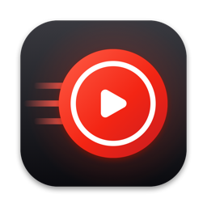
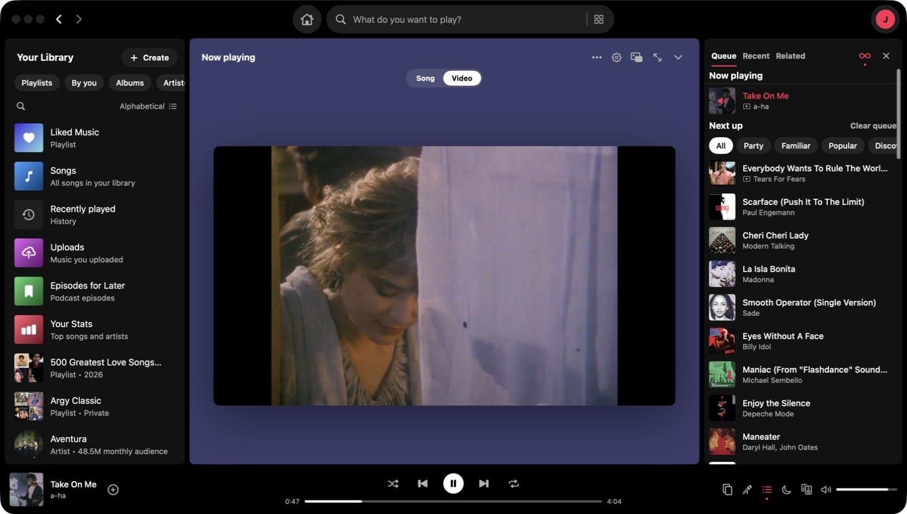
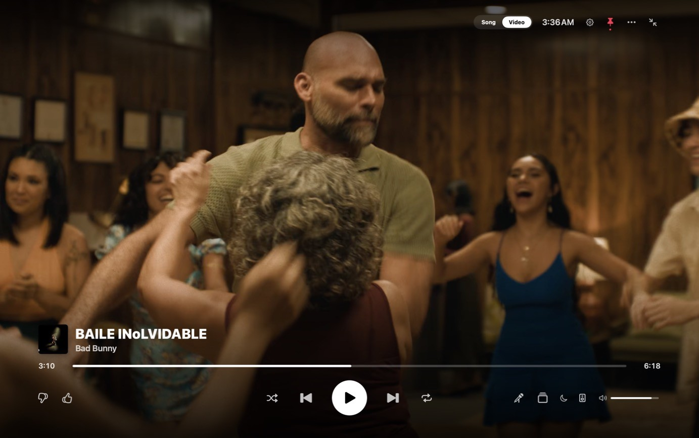
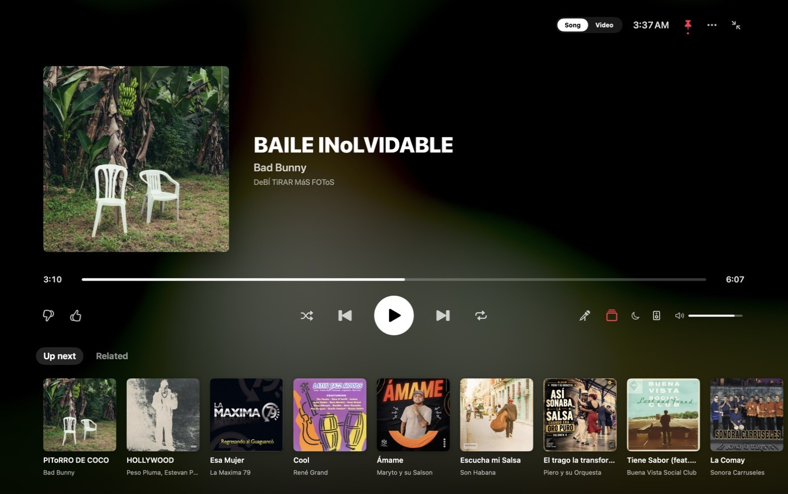

<p align="center">
  
</p>

<h1 align="center">YT Musicfast</h1>

<p align="center"><strong>A fast, native Mac app for YouTube Music.</strong><br>
SwiftUI + AVFoundation. An 8 MB download, ~150 MB of RAM, 0% CPU when idle.</p>

<p align="center">
  <a href="https://github.com/MijaelFV/YTMusicfast/releases/latest"><strong>Download</strong></a> ·
  <a href="docs/features.md">Features</a> ·
  <a href="docs/privacy.md">Privacy</a> ·
  <a href="docs/troubleshooting.md">Help</a> ·
  <a href="CONTRIBUTING.md">Contribute</a>
</p>

<p align="center">
  <a href="docs/development.md"></a>
  
  <a href="LICENSE"></a>
</p>


<p align="center">
  
  
  
</p>

> **Independent project.** Not affiliated with, endorsed or sponsored by Google or YouTube. It uses YouTube Music's
> private web API, which can change without notice; when it does, playback may stop until an update ships.

## Install

```bash
brew install --cask mijaelfv/tap/ytmusicfast
```

Or download the DMG from [Releases](https://github.com/MijaelFV/YTMusicfast/releases/latest) and drag the app into
Applications. Builds aren't notarized yet: the first time, open it from **System Settings → Privacy & Security →
Open Anyway**. It updates itself after that. Requires macOS 15 Sequoia or later.

**Early days:** expect rough edges, and please [report what you find](https://github.com/MijaelFV/YTMusicfast/issues/new/choose).

## Highlights

| | |
|---|---|
| **Sound** | Opus up to 256 kbps with Premium; 10-band EQ, crossfade, gapless playback, volume normalization |
| **Full-screen TV mode** | The cover's colours across the screen, synced lyrics, an Up next rail, music videos up to 4K; driven with the arrow keys like a remote |
| **Offline** | Download albums and playlists; songs you've played replay instantly without data |
| **Content filter** | Hide AI-generated music, explicit songs, and artists or songs you choose |
| **Your account** | Mixes, Liked Music, playlists and History, kept in step with your phone and the website |
| **Play anywhere** | Google Cast, AirPlay, a phone remote, and Listen together with people nearby |
| **Your Stats** | Top songs and artists and when you listen, kept on your Mac |
| **Keyboard first** | Shortcuts for everything, a menu-bar player, a miniplayer, a notch player, a command-line tool and Shortcuts actions |

All of it, plus every keyboard shortcut: [Features](docs/features.md).

## Documentation

- [Features and keyboard shortcuts](docs/features.md)
- [Privacy](docs/privacy.md): what stays on your Mac and what goes over the network
- [Troubleshooting](docs/troubleshooting.md)
- [Development](docs/development.md): building, tests and architecture

## Acknowledgments

- [Sparkle](https://sparkle-project.org) (MIT) for in-app updates, and
  [yt-dlp/ejs](https://github.com/yt-dlp/ejs) (Unlicense) for Premium audio — their notices ship in the app
  (`ThirdPartyNotices.txt`, `Solver/`)
- [yt-dlp](https://github.com/yt-dlp/yt-dlp), whose work on YouTube's clients this app follows
- [LRCLIB](https://lrclib.net) for synced lyrics, and the [SponsorBlock](https://sponsor.ajay.app) community for
  marking non-music segments

## Contributing

See [CONTRIBUTING.md](CONTRIBUTING.md) and the [Code of Conduct](CODE_OF_CONDUCT.md). Security issues:
please follow [SECURITY.md](SECURITY.md). Licensed under the [MIT License](LICENSE).
